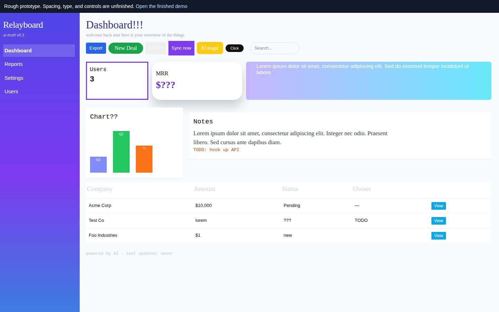
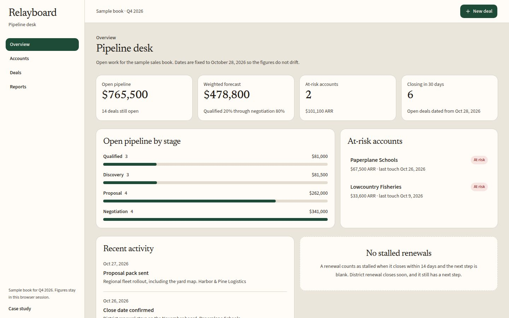
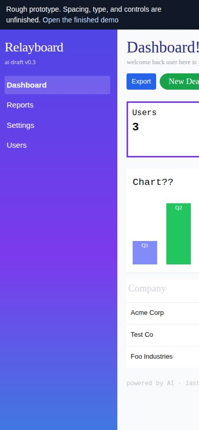
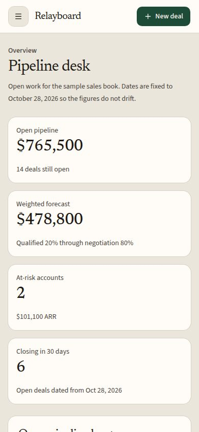

# Relayboard

Relayboard is a portfolio case study of a rough AI-generated SaaS prototype that was fixed and polished into a clickable product demo. The product is a fictional B2B pipeline desk for a sales team. `/before` keeps the unfinished draft: mixed typefaces, a purple gradient frame, dead buttons, three placeholder rows, and a canvas wider than a phone. `/after` is the same desk after the 24-item pass below: one type system, working search and filters, CSV export, a validated new-deal dialog, stage changes, account notes, and empty, loading, and error states. Every account, deal, amount, and activity line is fictional sample data, held in the browser session.

**Live demo:** https://relayboard-mu.vercel.app

Refreshing the browser restores the sample book. The app makes no model calls and stores nothing on a server.

## Before and after

Desktop frames are 1440×900. Phone frames are 390×844. Paths are relative to this file so the images render on GitHub.

### Desktop

| Rough prototype | Finished demo |
| --- | --- |
|  |  |

### Mobile

| Rough prototype | Finished demo |
| --- | --- |
|  |  |

## Fix checklist

The finished demo covers these 24 fixes.

### Type and color

1. Replaced Times, Georgia, Arial, Courier, and Trebuchet with one sans family and one heading face.
2. Locked the type scale. Removed one-off sizes such as 11px, 13px, 15px, 19px, and 31px.
3. Moved spacing onto a 4px scale. Removed 7px, 9px, 11px, and 13px gaps.
4. Put color and radius in CSS variables and dropped the indigo-to-violet gradient chrome.
5. Darkened muted text so labels clear WCAG AA on the paper background.

### Behavior

6. Removed dead controls: Filter, Sync now, the AI chip, Click, and per-row View.
7. Export downloads a CSV of the rows in the current view.
8. New deal opens a dialog, checks required fields, and adds the deal to the session.
9. Stage changes update the board and confirm with a toast.
10. Account names open a detail page. A note can be saved there for the session.
11. Removing a deal asks for confirmation, then updates the board.
12. Rows, cards, navigation, and buttons have hover and active states.

### Sample data

13. Replaced three placeholder rows and lorem with 12 accounts, 16 deals, and an activity log, using one currency and date format.

### States

14. Search and filters that match nothing show an empty state and a clear action.
15. Stalled renewals render an empty state instead of a blank box.
16. Refresh on reports replays a skeleton loading state, then restores the figures.
17. Reports can show an error state with retry.
18. Unknown account links render a not-found state, and the reports stub is now a finished view.

### Responsive layout

19. The page no longer forces an 1180px canvas, so phones do not scroll sideways.
20. Navigation collapses into a menu sheet on small screens.
21. Account rows become cards on narrow screens, and the pipeline scrolls inside the board.

### Accessibility

22. Form controls have visible labels. The rough search field had only a placeholder.
23. Focus rings stay visible. The rough build removed outlines on buttons.
24. Added a skip link, nav and main landmarks, and names on icon buttons.

## Lighthouse

Scores from one local lab run on 28 October 2026. Lighthouse 13.6.0 against `npm start` (Next.js 16.4.3 production server on localhost). Mobile rows use Lighthouse’s default mobile profile. This is a local trace, measured before the Vercel deploy.

| Page | Form factor | Performance | Accessibility | Best Practices | SEO |
| --- | --- | --- | --- | --- | --- |
| `/` case study | Mobile | 100 | 100 | 100 | 100 |
| `/after` overview | Mobile | 99 | 100 | 100 | 100 |
| `/after` overview | Desktop | 100 | 100 | 100 | 100 |
| `/after/accounts` | Mobile | 100 | 100 | 100 | 100 |
| `/after/deals` | Mobile | 99 | 100 | 100 | 100 |
| `/after/reports` | Mobile | 100 | 100 | 100 | 100 |
| `/before` rough overview | Mobile | 100 | 90 | 100 | 100 |

On the finished routes, Accessibility, Best Practices, and SEO are 100. Performance landed at 99 or 100; the 99s are Total Blocking Time around 120–130 ms under simulated mobile throttling. The rough overview scores 90 on Accessibility: contrast, color-only links, a missing main landmark, and table cells without headers.

## Stack

- Next.js 16.4 (App Router) and React 19
- TypeScript 5
- Tailwind CSS 4, with Radix UI, shadcn/ui, Lucide, and Sonner
- ESLint 9 with `eslint-config-next`
- Sample data in the client session. Deploy needs no environment variables.

Vercel can use the default Next.js project settings. The build command is `npm run build`. There is no `basePath`.

## Run locally

```bash
npm install
npm run dev
```

Open [http://localhost:3847](http://localhost:3847).

```bash
npm run lint
npm run build
npm start
```

## Routes

| Route | What it is |
| --- | --- |
| `/` | Case study, punch list, and screenshots |
| `/before` | Rough overview. Buttons do nothing. |
| `/before/reports` | Unfinished reports stub |
| `/after` | Finished overview |
| `/after/accounts` | Searchable account book |
| `/after/accounts/harbor-pine` | Account detail |
| `/after/deals` | Pipeline board |
| `/after/reports` | Report with loading, empty, and error states |

## Credit

[Xavier Zhao](https://github.com/XavierZhao1989)
